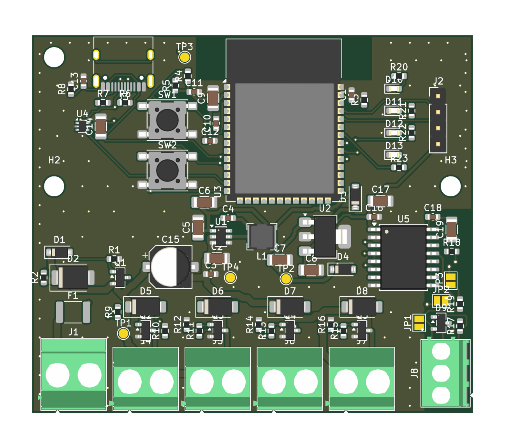
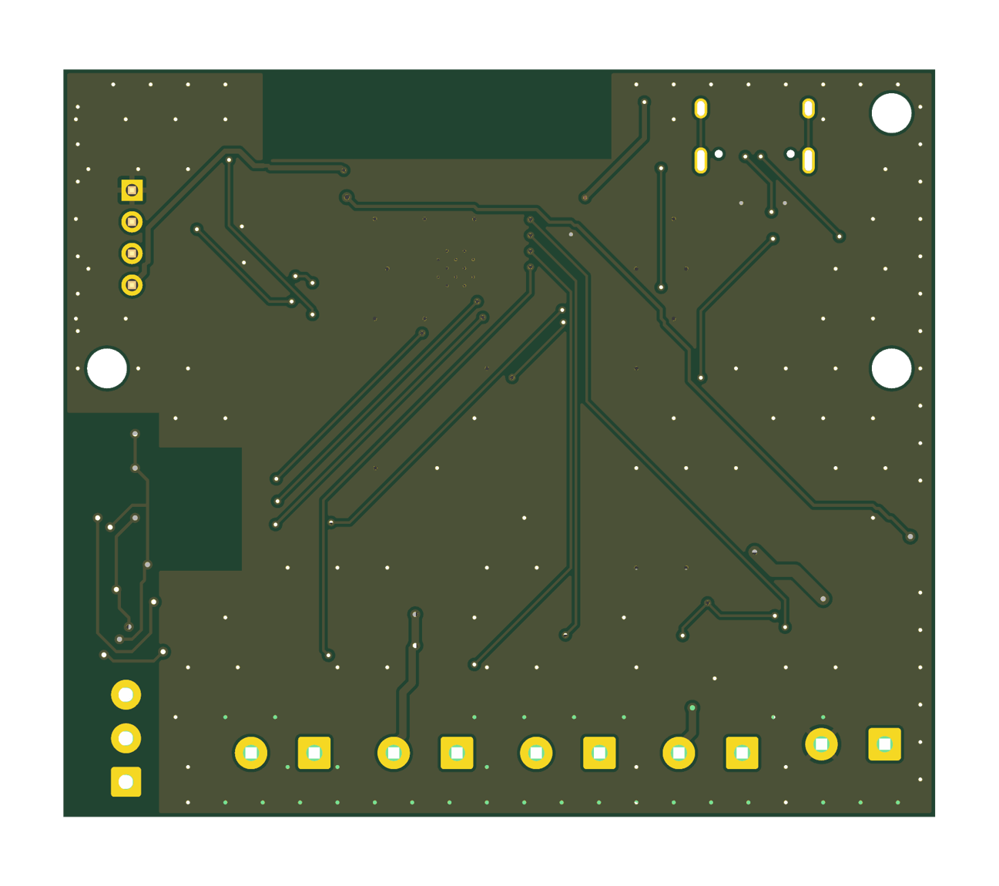

# Sprinkler Valve Controller — ESP32-S3, 12 V in, 4 valves, isolated RS485

**Status:** Rev A draft: schematic ERC clean, board routed and DRC clean (0 errors, 0 unconnected), fab files generated. Not ordered yet. This project is the simplified successor of the MPPT board (`../sprinkler-mppt-pcb`): PV and MPPT moved to a separate module.

## What it is

A small board that runs 4 sprinkler valves from a 12 V supply (battery, the PV/MPPT module, or a wall adapter; never above 15 V).

- **ESP32-S3-WROOM-1-N8**, firmware on Zephyr RTOS
- **4 valve outputs** (12 V, up to 1 A each, at most 2 on at once)
- **Isolated RS485** (CA-IS3092W) for Modbus RTU
- **USB-C** for flashing, BOOT and RESET buttons, debug header, 4 LEDs
- **12 V monitor** into the ESP32 ADC, so the firmware can stop the valves on a low battery
- **Input protection:** resettable fuse, reverse-polarity P-FET, TVS

Target board: 70 × 60 mm, 2 layers, all SMT parts on the top, only screw terminals and headers through-hole.

## Documents

| File | Content |
|------|---------|
| [docs/01-requirements.md](docs/01-requirements.md) | Requirements and assumptions |
| [docs/02-hardware.md](docs/02-hardware.md) | Power tree, valves, RS485, USB-C, protection |
| [docs/03-pinmap.md](docs/03-pinmap.md) | ESP32-S3 GPIO map |
| [docs/04-firmware.md](docs/04-firmware.md) | Firmware notes |
| [docs/06-bringup.md](docs/06-bringup.md) | Bring-up and test plan |
| [docs/07-parts-check.md](docs/07-parts-check.md) | Web check of the risky parts, LCSC numbers, risks |
| [docs/08-fabrication.md](docs/08-fabrication.md) | JLCPCB order settings, files, checks |
| [hardware/README.md](hardware/README.md) | How the schematic and board are generated |

## Schematic

PDF: [hardware/valve_controller_schematic.pdf](hardware/valve_controller_schematic.pdf). Generated from `hardware/valve_controller.py` (SKiDL); open `hardware/valve_controller.kicad_pro` in KiCad.

| Sheet | Content |
|-------|---------|
| `power_in` | 12 V terminal, fuse, reverse-polarity P-FET, TVS, 12 V monitor divider |
| `aux_power` | AP63205 5 V buck, USB 5 V OR, AP7361C 3.3 V LDO |
| `esp32` | ESP32-S3 module, BOOT and RESET, debug header |
| `usb_c` | USB-C connector, CC resistors, ESD protection |
| `valves` | 4 × AO3400A drivers with flyback diodes, screw terminals, bulk capacitor |
| `rs485` | CA-IS3092W, TVS, termination and bias jumpers, terminal |
| `leds` | 4 LEDs and resistors |
| `test_points` | V12, 5V, 3V3, GND |

## Board

Open `hardware/valve_controller.kicad_pcb` (or the project `hardware/valve_controller.kicad_pro`) in KiCad 10.

## Fabrication specs

| Item | Value |
|------|-------|
| Size | 70 x 60 mm, 3 x M3 mounting holes |
| Layers | 2, GND pour on both layers with stitching vias |
| Copper, finish | 1 oz, HASL lead-free (ENIG optional) |
| Track and space | 0.2 / 0.2 mm; V12 rail 1.0 mm, valve returns 0.6 mm, 5 V rails 0.5 mm |
| Vias | 0.6 / 0.3 mm |
| Antenna area | No copper in the strip at the top edge around the ESP32 antenna |
| RS485 isolation | Bus side right of the isolator: no GND pour, nothing under the chip body between the pin rows (about 7 mm) |
| Assembly | One side (top), SMT by JLCPCB; screw terminals and the debug header soldered by hand |
| Checks | ERC 0 violations; DRC 0 errors, 0 unconnected |

Files in `hardware/fab/`: `gerbers_valve_controller_RevA.zip` (and `gerber/`), `BOM_valve_controller.csv` (draft with suggested parts and rough prices), `BOM_JLCPCB_import.csv` (LCSC numbers to fill), `CPL_valve_controller.csv` (SMD positions, top side).

## Costs

**Rough estimates from memory, not quotes.** Upload the files to the JLCPCB quote page for real numbers. USD.

| Item | Estimate |
|------|----------|
| Components per board | about 14 (84 parts, 15 of the BOM lines are JLCPCB "extended" parts) |
| 5 bare 2-layer boards | about 2-8 |
| Shipping | 15-25 |
| JLCPCB SMT assembly fees (one side) | about 55-65 (setup, stencil, about 3 per extended part type) |
| **5 boards assembled by JLCPCB** (terminals and header soldered by hand) | **about 150-180, roughly 30-35 per board** |
| **2 boards assembled** | about 100-120 |
| **2 boards built entirely by hand** | about 50-70 (boards, shipping, parts) |

Open items before ordering: confirm stock and basic/extended class on the JLCPCB parts pages for the LCSC numbers in the BOM (see docs/07-parts-check.md), especially the LDO (low stock seen); the PTC fuse hold current drops when hot; two small silkscreen labels did not fit (RESET, BIAS B); terminal polarity labels are on the bottom side, next to the pads.
