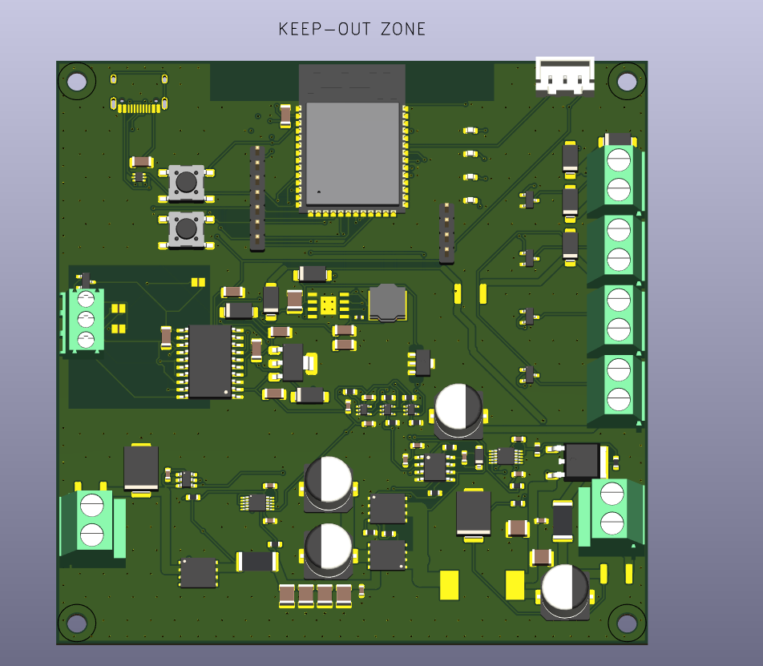
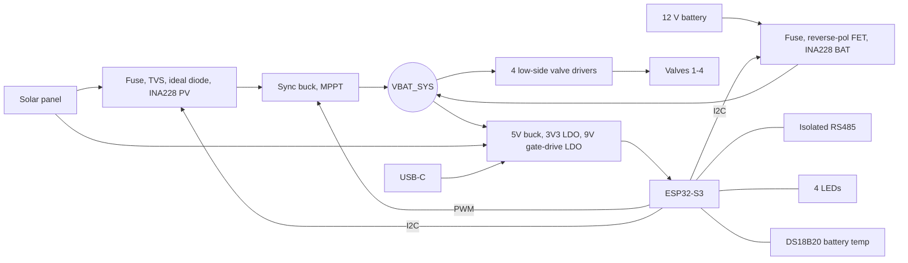
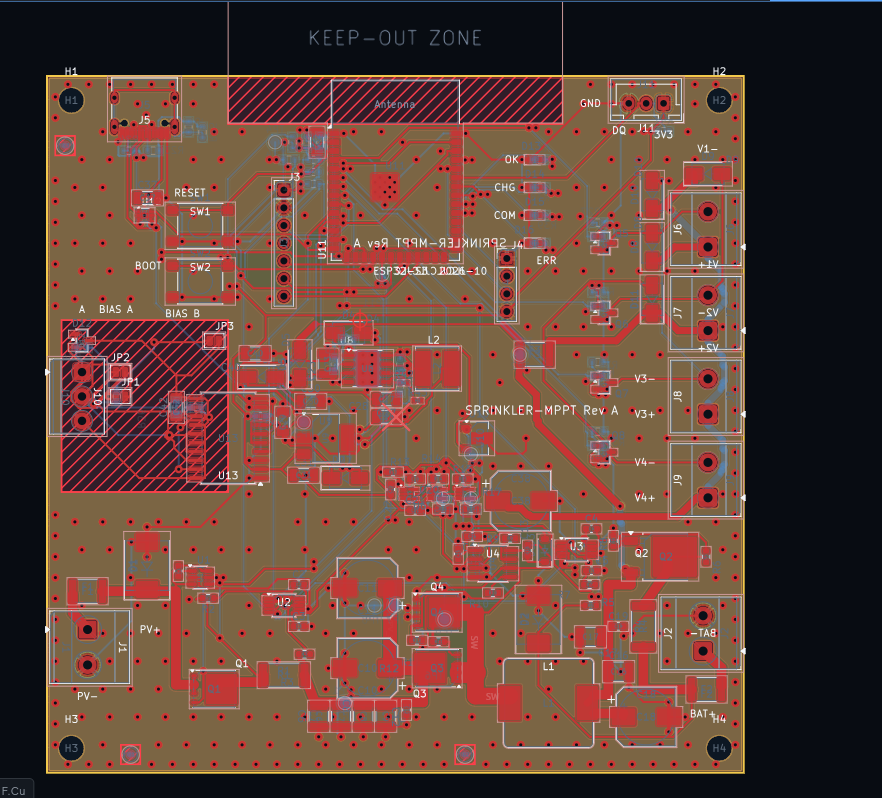
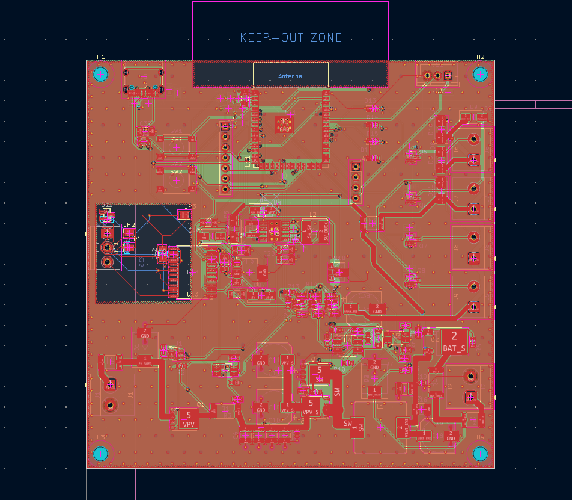
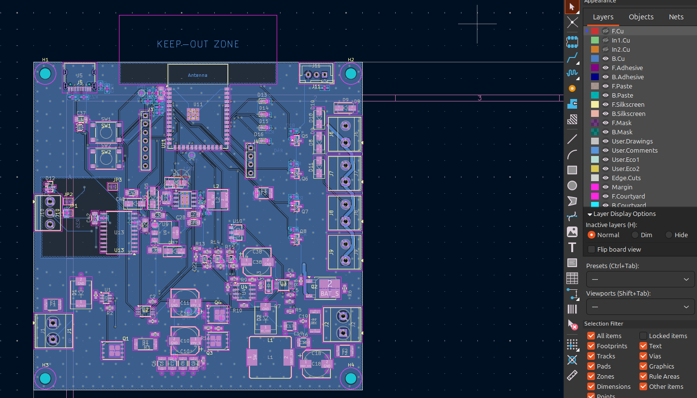

# Solar Sprinkler Controller PCB — ESP32-S3 + MPPT

**Status:** Rev A draft. Schematic ERC clean, board DRC clean, fabrication files generated. **Not ordered yet.** Part numbers and prices in the BOM are suggestions to verify against datasheets and the JLCPCB parts library before ordering.

## Overview

One 100 × 100 mm, 4-layer board that runs 4 sprinkler valves from an off-the-shelf solar panel and an off-the-shelf 12 V battery. An ESP32-S3 controls a small synchronous buck converter (MPPT charger), measures panel and battery voltage and current, and talks to the outside world over isolated RS485 and USB-C.

- **4 × 12 VDC solenoid valves** (non-latching), low-side drivers, at most 2 on at once
- **Solar panel:** a "12 V" panel (Voc up to 25 V, working voltage 16 V or more), 20–50 W
- **Battery:** any 12 V battery. LiFePO4 with a built-in BMS is recommended; 3S Li-ion and lead-acid work with a different firmware profile
- **MPPT charger:** synchronous buck, 100 kHz, 5 A hardware (2 A firmware limit for small packs), controlled by the ESP32-S3
- **Sensing:** voltage and current of panel and battery (2 × INA228), battery temperature (DS18B20 probe)
- **Comms and IO:** isolated RS485 (ADM2587E), USB-C native USB for flashing and debug, 4 status LEDs
- **Firmware:** Zephyr RTOS (ESP32-S3-WROOM-1-N8, 8 MB flash, no external flash)

Supported power situations: panel + battery, and battery only. Panel only without a battery, and a 12 V source on the solar input, are **not** supported (details in [docs/02-hardware.md](docs/02-hardware.md), section 2.1b).

## Objectives

| # | Objective | How the board meets it |
|---|-----------|------------------------|
| 1 | Water 4 zones from solar power, off grid | 4 valve drivers, battery-backed, panel charges the battery |
| 2 | Squeeze the most out of a small cheap panel | ESP32-controlled MPPT sync buck, perturb and observe |
| 3 | Work with any cheap 12 V battery | Chemistry profile set in firmware; battery side has reverse-polarity FET, fuse, TVS |
| 4 | Valves off at power-up, reset and crash | Pull-downs on every driver, hardware gate on the charger driver, firmware watchdog |
| 5 | Never charge outside 0–45 °C, never overcharge | Battery temperature probe, INA228 over-voltage alert wired to the gate driver |
| 6 | Talk to a building controller over a long cable | Isolated RS485 (Modbus RTU), terminated and biased with solder jumpers |
| 7 | Easy to flash and debug | USB-C native USB, BOOT and RESET buttons, debug header, test points |
| 8 | Small battery and PV edge-AI models | ESP32-S3 with vector instructions; model size kept small (see docs/04-firmware.md) |

## Block diagram

## Schematics

Full schematic: [hardware/sprinkler_mppt_schematic.pdf](hardware/sprinkler_mppt_schematic.pdf) (11 pages). Open it in KiCad from `hardware/sprinkler_mppt.kicad_pro`. The schematic is generated from `hardware/sprinkler_mppt.py` (see [hardware/README.md](hardware/README.md)); sheets use net labels instead of drawn wires.

| Sheet | Content |
|-------|---------|
| `pv_input` | Panel terminal, fuse, TVS, ideal diode (LM74700-Q1), PV shunt and INA228 |
| `battery_input` | Battery terminal, fuse, TVS, reverse-polarity P-FET, battery shunt and INA228 |
| `mppt_buck` | Half-bridge buck (2 × BSC028N06LS3), LM5109B gate driver, 33 µH inductor, input and output caps |
| `aux_power` | 5 V buck (LMR33630, 100 k / 24.9 k divider), 3V3 LDO (AP7361C), 9 V gate-drive LDO (L78L09) |
| `esp32` | ESP32-S3-WROOM-1-N8, BOOT and RESET buttons, debug and spare headers |
| `usb_c` | USB-C connector, CC resistors, ESD protection (USBLC6-2P6) |
| `valves` | 4 AO3400A drivers, flyback diodes, screw terminals, valve fuse |
| `rs485` | ADM2587E isolated transceiver, TVS, termination and bias jumpers |
| `leds_temp` | 4 LEDs, DS18B20 connector |
| `test_points` | 11 test points |

Detailed design notes: [docs/02-hardware.md](docs/02-hardware.md). GPIO map: [docs/03-pinmap.md](docs/03-pinmap.md).

## PCB

## Fabrication specs

Everything is set in `hardware/sprinkler_mppt.kicad_pcb`; fabrication files are in `hardware/fab/`.

| Item | Value |
|------|-------|
| Manufacturer | JLCPCB, assembled by JLCPCB (SMT on both sides, through-hole parts by hand or selective soldering) |
| Board size | 100 × 100 mm, 4 × M3 mounting holes |
| Layers | 4: F.Cu signal and power, In1 GND plane, In2 3V3 plane, B.Cu signal and power |
| Stackup | JLC04161H-7628, 1.6 mm total; prepreg 0.2104 mm between outer and inner layers |
| Copper | 1 oz outer (35 µm), 0.5 oz inner (17.5 µm) |
| Surface finish | ENIG |
| Track and space | 0.2 / 0.2 mm default (JLCPCB minimum is 0.09 mm) |
| Power tracks | 1.4 mm (5 A charge path), 1.0 mm (valve rail and feed), switch node 2.4 mm bars |
| Vias | 0.6 / 0.3 mm (signal and stitching), 0.8 / 0.4 mm (power); smallest drill 0.2 mm (ESP32 pad vias) |
| Rules set | Hole to hole 0.5 mm, copper to edge 0.3 mm, solder mask expansion 0.05 mm |
| Pours | GND pour on F.Cu and B.Cu with stitching vias; none in the antenna keep-out or the RS485 isolation area |
| RS485 isolation | In1 and In2 planes are cut under the bus side of the isolator; no logic copper inside |
| Silkscreen | 1.0 mm text, 0.15 mm line; board name and revision, terminal polarity labels; `JLCJLCJLCJLC` placeholder for the order number on the bottom side |
| Fiducials | 3 per side |
| Checks | ERC 0 violations; DRC 0 errors and 0 unconnected, including schematic parity |

Files in `hardware/fab/`:

| File | Content |
|------|---------|
| `gerbers_sprinkler_mppt_RevA.zip` | All Gerber layers and drill files (also unpacked in `gerber/`) |
| `BOM_sprinkler_mppt.csv` | Draft BOM: 72 lines, 154 parts, suggested part numbers, rough prices |
| `BOM_JLCPCB_import.csv` | Same list in JLCPCB's BOM import format; LCSC part numbers still empty |
| `CPL_sprinkler_mppt.csv` | Pick-and-place positions (check rotations in JLCPCB's preview before ordering) |

## Costs

**These are rough estimates from memory, not quotes.** Upload the files to the JLCPCB quote page for real numbers. Prices in USD.

| Item | Estimate | Notes |
|------|----------|-------|
| Components per board | about 49 | From the draft BOM, one board |
| 5 bare 4-layer boards, ENIG, 1 oz | 25–45 | 100 × 100 mm |
| Shipping to Italy | 15–30 | |
| JLCPCB assembly fees, 5 boards | 100–150 | Setup, stencil, a fee for each unusual part type, two-sided |
| **5 bare boards (you solder)** | **50–75 plus about 250 parts** | Parts for 5 boards |
| **5 boards assembled by JLCPCB** | **450–650** | About 90–130 per board |
| **2 boards built by hand** | **170–200** | Bare boards plus parts for 2 |

Most expensive parts per board (estimates):

| Part | Estimate |
|------|----------|
| ADM2587E isolated RS485 (U13) | 10.00 |
| ESP32-S3-WROOM-1-N8 (U11) | 4.20 |
| INA228 × 2 (U2, U3) | 8.40 |
| Inductor 33 µH 8 A (L1) | 2.20 |
| LMR33630 5 V buck (U8) | 2.20 |
| BSC028N06LS3 × 3 (Q1, Q3, Q4) | 3.30 |
| 10 µF 50 V ceramics × 5 | 1.75 |

Ways to bring it down: order bare boards first; swap INA228 for the pin-compatible INA226 (about 5 less per board); use a cheaper or non-isolated RS485 chip; build 1–2 boards by hand.

## Open items before ordering

- Pick real parts and fill in the LCSC numbers; verify the 10 A fuse in a 1812 package exists
- Check the 5 V buck inductor current rating and the output capacitors against the LMR33630 datasheet
- Confirm the ADM2587E, INA228, LM5109B and 74LVC1G08 pinouts against datasheets (LM74700-Q1, LMR33630 and AP7361C are verified)
- LM5109B has no dead time: confirm Zephyr's PWM can add it or add a small hardware delay
- Add three missing silkscreen labels by hand (RS485 terminal B, GND on the RS485 and temperature connectors, TERM on its jumper)
- Check pick-and-place rotations in JLCPCB's preview; have an engineer review the hot loop and the isolation clearances

## Documents

| File | Content |
|------|---------|
| [docs/01-requirements.md](docs/01-requirements.md) | Requirements, what to buy, assumptions |
| [docs/02-hardware.md](docs/02-hardware.md) | Power tree, MPPT buck, sensing, valves, RS485, USB-C, LEDs, protection |
| [docs/03-pinmap.md](docs/03-pinmap.md) | ESP32-S3 GPIO map |
| [docs/04-firmware.md](docs/04-firmware.md) | MPPT, charge profile, valve logic, platform decisions |
| [docs/05-pcb-and-bom.md](docs/05-pcb-and-bom.md) | Early PCB proposal (superseded by `hardware/`) |
| [docs/06-bringup.md](docs/06-bringup.md) | Bring-up and test plan |
| [docs/07-floorplan.md](docs/07-floorplan.md) | Early placement sketch (superseded) |
| [hardware/README.md](hardware/README.md) | How the schematic and board are generated and routed, helper scripts |

## Where things are

| Path | What |
|------|------|
| `docs/` | Requirements, hardware design, pin map, firmware notes, bring-up, images |
| `hardware/sprinkler_mppt.kicad_pcb` | The routed 4-layer board (the only PCB file) |
| `hardware/*.kicad_sch` | Schematic sheets |
| `hardware/sprinkler_mppt_schematic.pdf` | Schematic PDF |
| `hardware/fab/` | BOM, JLCPCB BOM import file, pick-and-place file, Gerbers and drill files |
