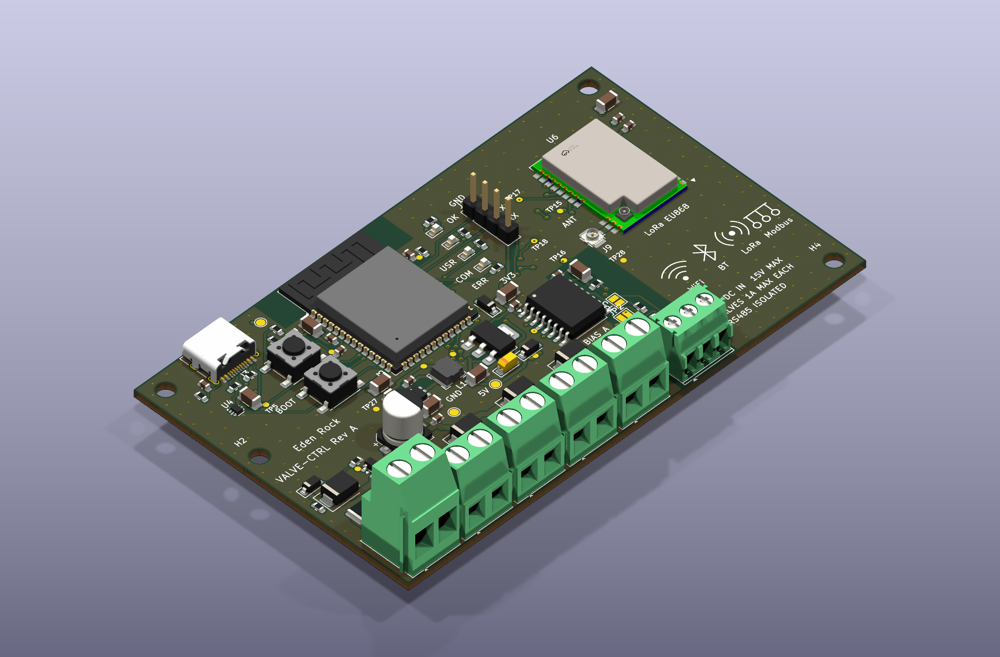

# 10. Board layout and capabilities (Rev C)

100 × 60 mm, 2 layers, four M3 holes. The silkscreen icons at the bottom right (WiFi, BT, LoRa, Modbus) show what the board can do at a glance. Under them are the ratings: `12V DC IN 15V MAX`, `VALVES 1A MAX EACH`, `RS485 ISOLATED`. The "Villa La Gatta Sensors & Control" text is on the bottom side.

## Capabilities

| Icon | What it is | Part | Notes |
|------|-----------|------|-------|
| WiFi | 2.4 GHz WiFi | ESP32-S3-WROOM-1-N8 (U3) | Module PCB antenna, top edge |
| BT | Bluetooth LE 5 | same module | |
| LoRa | Single-channel EU868 LoRa gateway for the user's own sensors | Ebyte E22-900M22S (U6, SX1262, 22 dBm) | u.FL antenna connector J9, SPI to the ESP32 |
| Modbus | Isolated RS485, Modbus RTU | CA-IS3092W (U5) | Terminal J8 (A, B, GND), bias and termination jumpers JP1-JP3 |

Also on the board: 4 valve outputs (AO3400A drivers, 1 A each, at most 2 on at once), USB-C for flashing and debug, BOOT and RESET, 4 status LEDs, 12 V monitor on the ADC.

## Where things are

Looking at the board from the top, USB-C at the top left (see picture).

| Area | Content |
|------|---------|
| Top left | USB-C (J3), ESD protection (U4), BOOT (SW2) and RESET (SW1) |
| Top centre | ESP32-S3 module (U3). Its antenna sticks out at the top edge, with no copper above or around it |
| Centre right | LEDs (OK, USR, COM, ERR) and the debug header J2 (GND, TX, RX) |
| Right | LoRa module U6 with its u.FL connector J9 (labelled ANT) on the left of it |
| Centre | Power: AP63205 buck (U1, L1), AMS1117 3.3 V LDO, USB/12 V power OR, 5 V and 3V3 test points |
| Centre right, below the ESP32 | RS485 isolator U5. The isolation barrier runs under it, jumpers JP1-JP3 for bias and termination |
| Bottom edge | 12 V input terminal J1, valve terminals J4-J7, RS485 terminal J8 (all face downwards) |
| Left, middle | Input protection: fuse F1, reverse-polarity P-FET, TVS, bulk capacitor |

## Layout rules that matter

- **ESP32 antenna:** no copper or tracks in the strip x 26-54 mm, y 0-7.2 mm at the top edge.
- **LoRa module:** no tracks under the module body (datasheet rule). SPI and power are routed around it. Antenna trace 0.9 mm from the module's ANT pad to J9.
- **RS485 isolation:** no GND pour and nothing on the bus side of U5 (right of it and around J8), and nothing under the chip between the pin rows.
- **GND:** pours on both layers, stitched with vias. Pieces that would be cut off are bridged with vias.
- **Track widths:** V12 rail 1.0 mm, valve returns 0.6 mm, 5 V rails 0.5 mm, signals 0.2 mm.
- **Input:** 12 V (never above 15 V). USB-only operation works for the logic and LoRa, valves need the 12 V input.

## ESP32-S3 pins

Full map in [03-pinmap.md](03-pinmap.md). In short: valves GPIO4-7, RS485 UART1 GPIO16-18, LEDs GPIO38-41, 12 V monitor GPIO1, LoRa SPI and control GPIO2, 21, 35, 36, 37, 42, 47, 48. Unused and marked no-connect: GPIO3, 8-15, 45, 46. No header for them on this revision.

## Test points

V12, 5V, 3V3 and GND. See [06-bringup.md](06-bringup.md) for the order to power up and test.

## Design checks (Rev C)

| Check | Result |
|-------|--------|
| ERC | 0 violations |
| DRC | 0 errors, 0 unconnected nets |
| DRC warnings | Silkscreen over copper or edge, mounting holes without symbol, jumper and test point footprints not in the schematic library: all cosmetic |
| Schematic vs board | In parity |
| Assembly | 40 BOM lines for JLCPCB (SMT only), 75 placements. Screw terminals J1, J4-J8 and header J2 are soldered by hand |

## Known items for bring-up

- **LoRa antenna path:** the E22 has its own IPEX connector as well as the ANT pad wired to J9. Check which one is active by default and fit the antenna there.
- **Firmware must set:** DIO2 as RF-switch control (TXEN is tied to it), RXEN (GPIO21) high while receiving, DIO3 as 1.8 V TCXO supply.
- **USB-only power:** the 3.3 V LDO has only about 0.2 V of dropout margin at 0.6 A when running from USB alone. Fine for bring-up, use 12 V for full load.
- **D10 and D11:** JLCPCB matches both LEDs to the same part (C965805). Check the colours on arrival. C2287 is a real yellow if D11 needs to change.

## Source files

| File | Content |
|------|---------|
| `hardware/valve_controller.py` | Schematic source (SKiDL) |
| `hardware/valve_controller_schematic.pdf` | All schematic sheets |
| `hardware/valve_controller.kicad_pcb` | Routed board |
| `hardware/fab/` | Gerbers zip, BOM, CPL |
| `hardware/add_icons.py` | Draws the capability icons on the silkscreen |
| `hardware/gen_fab.py` | Exports Gerbers and CPL |
